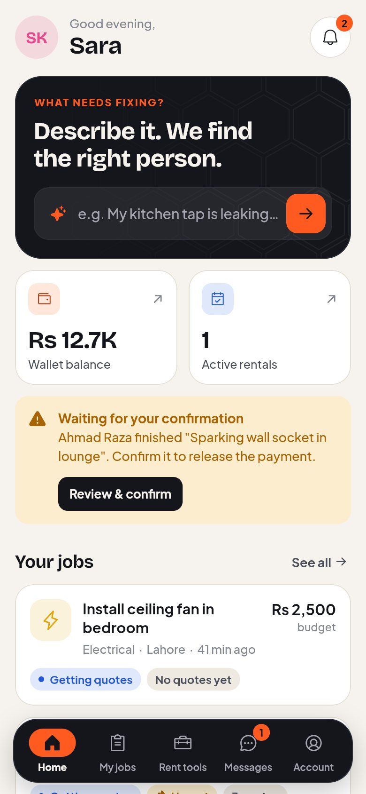
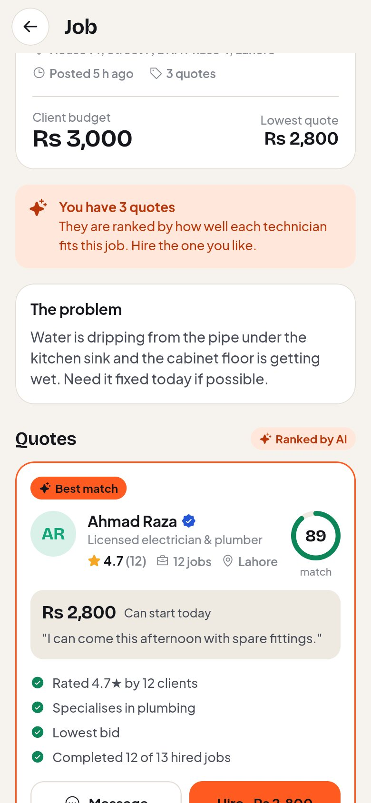
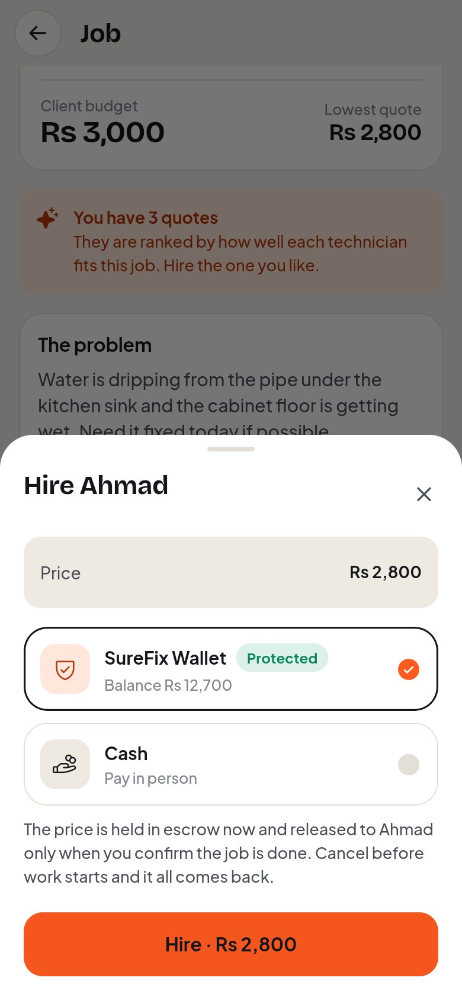
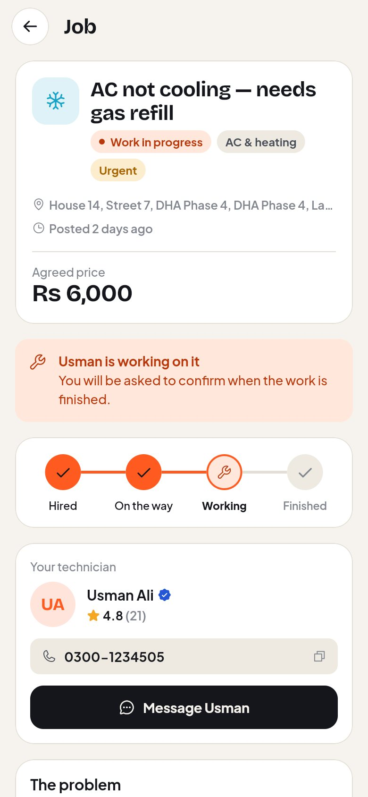
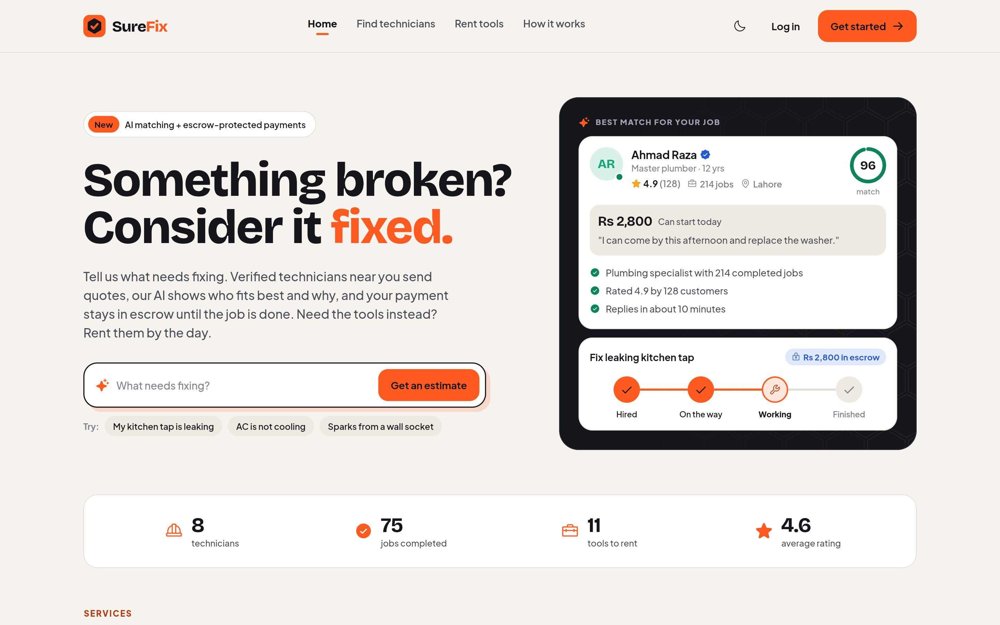
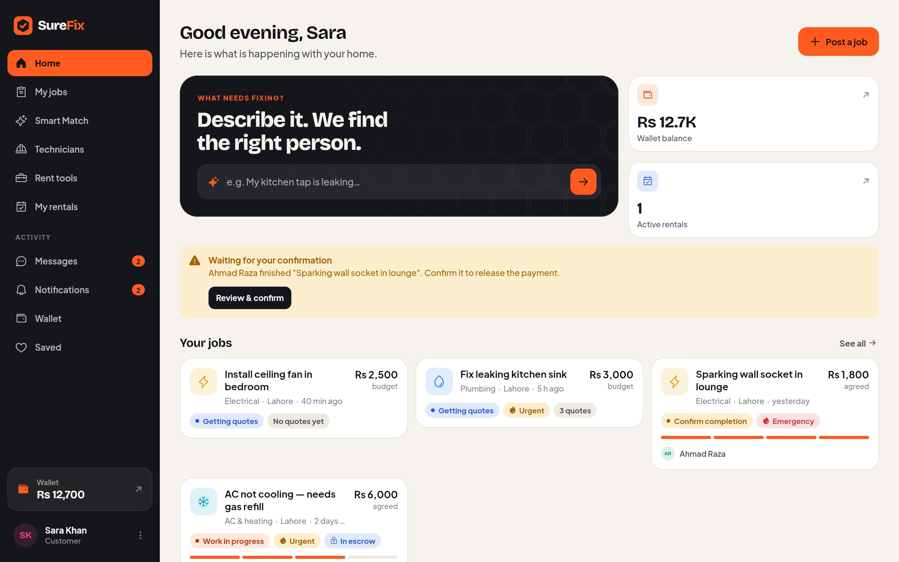
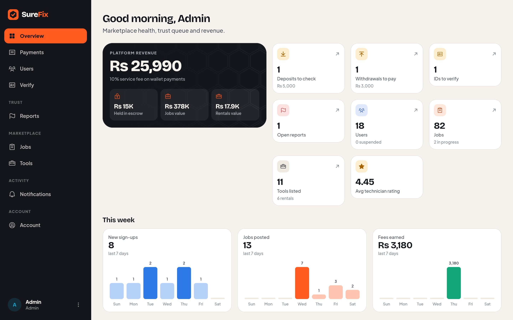
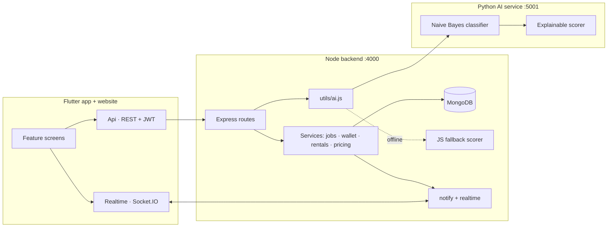

# SureFix — home repairs and tool rentals you can be sure about

SureFix is a marketplace that connects **customers**, **technicians** and **tool suppliers**
in one mobile app **and website**. A customer describes a problem in their own words; an
**AI engine works out the trade, the urgency and a fair price**, ranks the technicians who
quote and **explains why each one fits**. The payment waits in **escrow** while the customer
follows the job live, and is released only when they confirm the work. Anything a job needs
can be rented by the day from local suppliers, or bought in monthly installments.

<p align="center">
  
  
  
  
</p>

On a computer the same code is a **website**: a public landing page, technician directory
and tool market for visitors, and a sidebar web app for every role.

<p align="center">
  
</p>
<p align="center">
  
  
</p>

| Layer | Tech |
|---|---|
| App + website | Flutter 3.35 (Android, iOS, web, Windows) · one codebase, phone and website layouts · light & dark themes |
| Backend | Node.js 18+ · Express 5 · MongoDB (Mongoose) · JWT auth · Socket.IO realtime |
| AI service | Python · FastAPI · Naive Bayes text classifier + explainable ranking |
| Ops | Docker Compose · GitHub Actions CI · 150+ automated tests |

---

## What each role can do

**Customer**
- **Describe it, get matched.** "AC is running but the room is not cold" → the AI suggests
  *AC & heating*, the urgency, and what such jobs usually cost on SureFix.
- **Find who is near.** Use your phone's location, drop a pin on the map or pick your area,
  then filter technicians and tools by distance (2–50 km), trade, rating, price and more. Every
  card says how far away it is ("2.3 km · DHA Phase 5"), nearest first.
- **Post a job** (photos, budget, date, location) or send a **direct request** to one technician.
- **Compare AI-ranked quotes**: a match score out of 100 with plain-language reasons
  ("Specialises in plumbing", "Rated 4.7★ by 12 clients", "Lowest bid") and cautions.
- **Hire with escrow or cash.** Wallet payments are held by SureFix, not paid out.
- **Follow the job live**: hired → on the way → working → finished, with the technician's
  work report and photos. **Confirm** to release the payment, then rate and review.
- **Rent tools** by the day (pickup or delivery, refundable deposit, late fees) or **buy in
  monthly installments**; save favourite technicians and tools.

**Technician** — earnings dashboard (this month, in escrow, wallet) · availability switch ·
direct requests · jobs matching their skills with live alerts · **jobs near them** with the
distance, filtered by radius, urgency and budget · how far they travel for work · quotes with a price hint and
the fee shown up front · one-tap progress updates · finish with a note and photos · profile
with skills, rates and a **portfolio** · identity verification for the blue seal.

**Supplier** — revenue dashboard · shop location (customers see how far each tool is) · tool listings with photos, deposit, stock and installment
terms · approve / decline requests (stock reserved atomically) · take tools back with
automatic late fees · record installment payments · chat with customers.

**Admin** — **payments desk**: check deposits against the statement and approve or reject
them, pay out withdrawals, manage the company accounts users send money to · platform revenue
and escrow · 7-day charts · user search with suspend and safe delete · identity verification
queue · reports queue · **dispute resolution** (refund the customer or release to the
technician) · full payments ledger.

**Everyone** — realtime notifications that open the right screen, chat with read receipts,
typing and photos, a **wallet** with a full ledger (money in by bank or mobile-wallet transfer,
checked by an admin; money out by withdrawal request), password reset by emailed code,
report a problem, dark mode.

---

## Quick start (Windows)

Everything runs natively — see **[WINDOWS_SETUP.md](./WINDOWS_SETUP.md)** for the full guide.

```bat
.\setup.bat                      :: once (and again after pulling new code)

.\scripts\start-mongo.bat        :: skip if MongoDB runs as a Windows service
.\scripts\start-backend.bat      :: http://localhost:4000
.\scripts\start-ai.bat           :: http://localhost:5001  (docs at /docs)
.\scripts\start-mobile.bat       :: phone/emulator (add a device id as an argument)
.\scripts\start-web.bat          :: the website in Chrome, http://localhost:8080
```

> **Upgrading from an earlier version?** The data format changed. After pulling, run
> `.\setup.bat` and then `.\scripts\reset-demo-data.bat` once (it wipes the database and
> loads fresh demo data).

The demo data has 13 accounts, jobs in every state, quotes, reviews, tools, rentals,
installment plans, wallet history and chats. All demo passwords are `password123`:

| Role | Email |
|---|---|
| Customer | `client@demo.com` (also `client2@demo.com`) |
| Technician | `tech@demo.com` (also `tech2`…`tech8@demo.com`) |
| Supplier | `supplier@demo.com` (also `supplier2@demo.com`) |
| Admin | `admin@demo.com` |

The log-in screen has one-tap **demo account** buttons.

### Real Android phone over USB

```bat
adb reverse tcp:4000 tcp:4000
```
Run once per USB connection, before launching the app. Or point the app at your PC's
LAN IP: `flutter run --dart-define=API_BASE_URL=http://192.168.1.10:4000`.

### Docker (backend + AI + MongoDB)

```bash
docker compose up --build
docker compose exec backend npm run seed -- --force   # optional demo data
```

---

## Tests

```bat
.\scripts\test-all.bat          :: backend + AI service + Flutter
```

| Suite | Command | What it covers |
|---|---|---|
| Backend (92) | `cd backend && npm test` | Auth and password reset, the job lifecycle, escrow hold / release / refund, fees, deposits and withdrawals with admin approval (duplicate transaction IDs, double approval, held payouts), **near-me search** (radius, coverage, distances without leaking coordinates), rentals, late fees, installments, chat, privacy, admin disputes and cascading delete, uploads, AI fallback — against a real MongoDB |
| AI service (34) | `cd ai-service && pytest` | Stemming, held-out classifier accuracy, urgency, scoring properties (nearer ranks higher), API contract, **JS ↔ Python parity** |
| App (43) | `cd mobile && flutter test` | Models and formatting; **every screen rendered at phone and desktop size** against a fake backend to catch layout overflows; hiring, confirming, quoting, approving, deposit, withdrawal and payment-review flows; near-me filters, the area picker and profile location |

GitHub Actions runs all three on every push (`.github/workflows/ci.yml`).

---

## Architecture



- **Escrow is a ledger, not a flag.** Every wallet movement is a `Transaction` row; holds,
  releases, refunds and the platform fee are atomic and tested.
- The backend **never depends** on the AI service being up: if it is unreachable,
  `backend/src/services/scoring.js` (a port of the Python scorer, verified by a parity test)
  answers instead and responses say `"engine": "fallback"`.
- Details: [docs/ARCHITECTURE.md](./docs/ARCHITECTURE.md) (data model, lifecycles, REST API,
  realtime events, AI pipeline, security) · [ai-service/README.md](./ai-service/README.md).

## Project layout

```
backend/      Express API, Socket.IO, Mongoose models, services, Jest tests
ai-service/   FastAPI service: classifier, urgency, scoring, pytest tests
mobile/       Flutter app + website (lib/core, lib/ui design system, lib/features)
scripts/      Windows start / test / demo-data helpers
docs/         Architecture, installation, user guide, status, screenshots
```

## Documentation

| | |
|---|---|
| [WINDOWS_SETUP.md](./WINDOWS_SETUP.md) | Install + run on Windows, upgrading, troubleshooting |
| [docs/INSTALLATION.md](./docs/INSTALLATION.md) | All platforms, environment variables, Docker, app builds |
| [docs/ARCHITECTURE.md](./docs/ARCHITECTURE.md) | Components, data model, lifecycles, REST API, realtime events, AI pipeline |
| [docs/USER_GUIDE.md](./docs/USER_GUIDE.md) | Walkthrough for each role |
| [docs/STATUS.md](./docs/STATUS.md) | What is implemented, known limitations, changelog |

## Good to know

- **How money gets into and out of the wallet.** There is no payment gateway. Customers send
  money to one of the company accounts listed in the app (bank or JazzCash/Easypaisa), then
  enter the amount and the transaction ID; an admin checks the statement and approves it,
  which credits the wallet. Withdrawals work the other way round: the user enters their
  account, the amount is set aside at once, and the admin approves after sending it (or
  rejects, which returns the money). **Replace the demo company accounts** in
  Admin → Payments → Company accounts before real use.
- **Locations.** Exact positions are never shown to other people — only the area name and the
  distance. "Use my current location" needs a phone or a browser on `localhost`/HTTPS; anyone can
  pick their area from the list instead. The map picker uses OpenStreetMap tiles (internet needed).
- **Password reset codes** are emailed when `SMTP_URL` is set in `backend/.env`. Without it
  the code is printed in the backend console and shown on screen, so the flow can be demoed.
- Prices are in Pakistani rupees (Rs).
- Set a strong `JWT_SECRET` in `backend/.env` before deploying anywhere public (the server
  refuses to start in production with the default).
