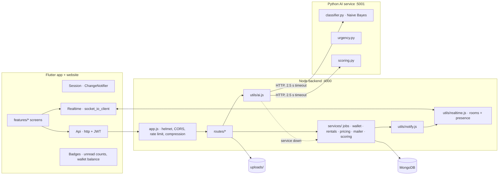
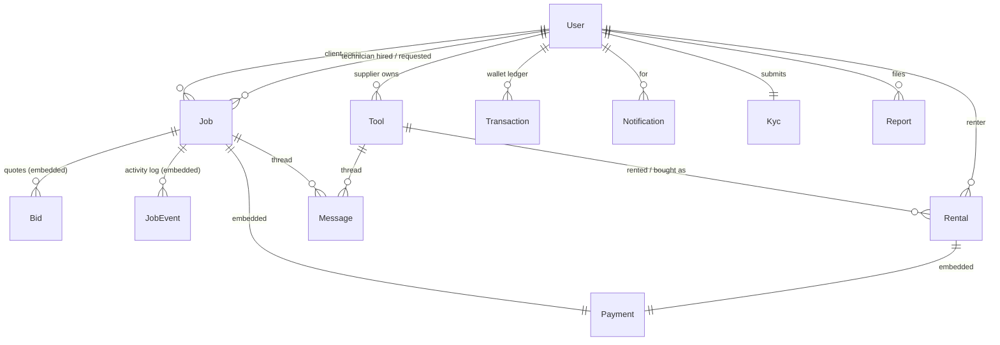
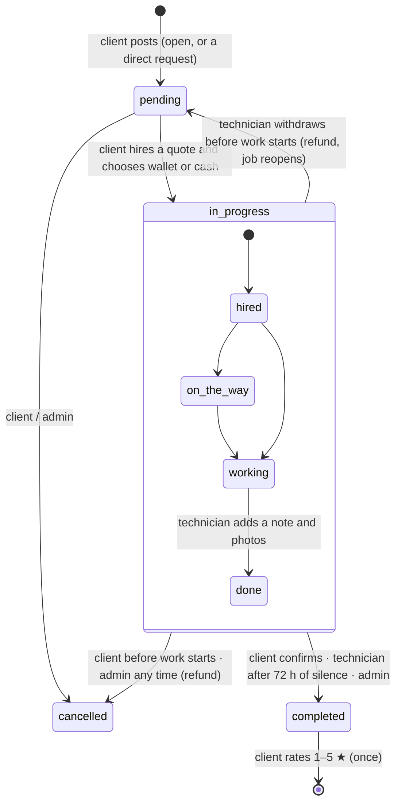
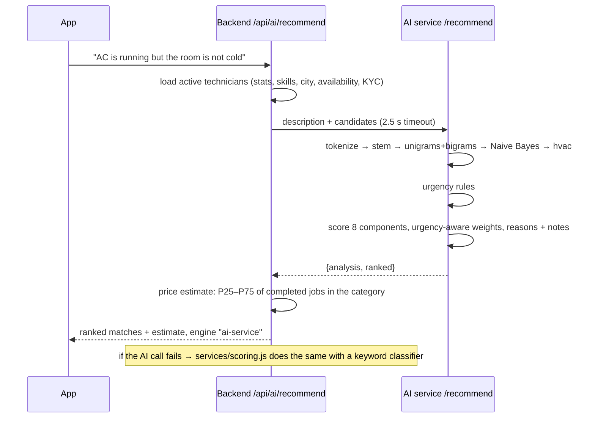

# Architecture

```
surefixing/
├── backend/      Node 18+ · Express 5 · Mongoose · Socket.IO        (:4000)
├── ai-service/   Python · FastAPI · Naive Bayes + explainable scorer (:5001)
├── mobile/       Flutter 3.35: Android / iOS app and the website
├── scripts/      Windows start / test / demo-data helpers
├── docker-compose.yml   MongoDB + backend + AI service in containers
└── docs/
```

## Components



- **One JWT for everything**: HTTP uses `Authorization: Bearer <jwt>`; the socket sends it in
  `handshake.auth.token`. Suspended users are rejected at login, on every API call, and their
  sockets are disconnected.
- **Rules live in services, routes stay thin.** `services/jobs.js` owns the job lifecycle,
  `services/wallet.js` owns every movement of money, `services/rentals.js` owns what a rental
  looks like to each side. Routes validate, authorise and call them.
- **AI is optional at runtime**: `utils/ai.js` calls the Python service with a timeout and falls
  back to `services/scoring.js`, a port of the same scorer (kept identical by a parity test in
  `ai-service/tests/test_scoring.py`). Every AI response carries `engine: "ai-service" | "fallback"`.
- **One Flutter codebase, two layouts.** Below 1000 px wide the app uses the phone layout: a
  bottom tab bar and stacked screens. On wider windows `features/shell/web_frame.dart` wraps the
  navigator in persistent chrome — a sidebar when signed in, the site header when signed out —
  and pages switch to multi-column layouts. The current section lives in `SiteNav` and is
  mirrored in the address bar (`#/tools`, `#/wallet` …); jobs, tools and technicians have their
  own addresses (`#/jobs/<id>`), so pages can be refreshed and shared.
- **Express 5** forwards async errors to one error handler (`middleware/error.js`), which turns
  Mongoose cast/validation errors, multer errors and bad JSON into clean `400`s. Errors are
  `{ error, code?, details? }` — e.g. `402 { code: "insufficient_funds" }`.

## Data model



| Model | Notable fields |
|---|---|
| **User** | role (client/technician/supplier/admin), status (active/suspended), kycStatus, avatar, city, address (private), bio · technician profile: headline, skills[], hourlyRate, experienceYears, isAvailable, portfolio[] · stats: rating, ratingCount, jobsCompleted, jobsAssigned, avgResponseMinutes · **walletBalance** · favoriteTechnicians[], favoriteTools[] · password-reset code hash, expiry and attempt counter |
| **Job** | client, title, description, category, budget, city, location, urgency, preferredDate, images[], **status** (pending / in_progress / completed / cancelled), **stage** (hired / on_the_way / working / done), requestedTechnician + requestDeclined, assignedTechnician, agreedPrice, bids[] {technician, amount, etaDays, message, status}, history[] {event, note, by, at}, completionNote, completionImages[], **payment**, rating, review |
| **Payment** (embedded) | method (wallet / cash), status (none / held / released / refunded / cash_due / cash_paid), amount, deposit, fee, net |
| **WalletRequest** | user, kind (deposit / withdrawal), amount, status (pending / approved / rejected / cancelled), deposit: companyAccount + sentTo snapshot, transactionId (normalised key for duplicate checks), proofImage · withdrawal: payout {method, provider, accountTitle, accountNumber} · adminNote, reference, reviewedBy, reviewedAt |
| **PaymentAccount** | kind (bank / mobile_wallet), provider, accountTitle, accountNumber, iban, instructions, active |
| **Transaction** | user (null = the platform), type (deposit, withdrawal, withdrawal_reversed, job_hold, job_refund, job_earning, rental_hold, rental_refund, rental_earning, installment_payment, installment_earning, platform_fee), signed amount, balanceAfter, job / rental, note |
| **Tool** | supplier, name, description, category, condition, city, images[], rentPricePerDay, deposit, purchasePrice, installmentMonths / Monthly, available (listed), stock, rating, ratingCount, rentalsCount |
| **Rental** | tool, renter, supplier, type (rent / installment), startDate, endDate, days, dailyRate, deposit, lateDays, lateFee, monthsTotal / monthsPaid / monthlyAmount, totalCost, **payment**, fulfillment (pickup / delivery), deliveryAddress, status (requested / active / returned / completed / rejected / cancelled) · computed in responses: overdue, daysLeft, monthsRemaining, handover `{method, address, city, revealed}` |
| **Message** | job *or* tool, sender, recipient, text, image, readAt |
| **Notification** | user, type, title, body, data {jobId / toolId / rentalId …}, readAt |
| **Kyc** | user, fullName, idType, idNumber, idFrontImage, idBackImage, selfieImage, status, rejectionReason |
| **Report** | reporter, targetType (user / job / tool), targetId, reason, details, status, resolutionNote |

## Lifecycles

### Job



- **Completion is two-sided.** The technician can only report the work as done; the client
  confirms. If the client does nothing for `AUTO_CONFIRM_HOURS` (72), the technician may close
  the job. A dispute goes to an admin, who refunds or releases.
- **Reliability is fair.** A client cancelling before work starts removes the hire from the
  technician's record; an admin can mark a refund as the technician's fault, which keeps it.
- **Privacy.** Phone numbers and emails are shared only between the client and the hired
  technician. Technicians see how many quotes a job has, never the others' prices — not even
  in the activity log.

### Money

```
wallet:  hire ──▶ held (client − price)  ──confirm──▶ released: technician + (price − fee), platform + fee
                                         ──cancel / withdraw──▶ refunded: client + price
cash:    hire ──▶ cash_due ──confirm──▶ cash_paid        (no fee, not protected)
```

`services/wallet.js` is the only code that changes a balance. A debit is one
`findOneAndUpdate({ walletBalance: { $gte: amount } })`, so a balance can never go negative and
two payments cannot both succeed; every change writes a `Transaction` with the balance after
it. The fee is `PLATFORM_FEE_PERCENT` (10) of wallet payments.

### Rental and installment plan

```
requested ──approve──▶ active ──return──▶ returned        (rent)
requested ──approve──▶ active ──last month paid──▶ completed (installment)
requested ──reject───▶ rejected      requested ──cancel (renter)──▶ cancelled
```

- **Rent by wallet**: cost + deposit are held at request time, refunded in full if declined or
  cancelled. On return the supplier is paid the cost minus the fee, plus any late fee; the
  renter gets the deposit back minus the late fee.
- **Late fee**: one daily rate per late day, capped at the deposit.
- **Installments**: each month is paid from the renter's wallet or recorded by the supplier
  as cash; the plan completes when the last month is paid.
- Stock is reserved on approve with an atomic `findOneAndUpdate({ stock: { $gt: 0 } })` and
  released on return. The pickup address and both phone numbers are revealed on approval.

## REST API

All paths start with `/api`. 🔒 = needs a JWT. 🌐 = also works signed out (the public website).
Lists accept `?page=&limit=` and return a plain array with the total in `X-Total-Count`.

### Auth, account, wallet

| Method | Path | Notes |
|---|---|---|
| POST | `/auth/register` · `/auth/login` | → `{token, user}`; `403 {code:"suspended"}` for suspended accounts |
| POST | `/auth/change-password` 🔒 | `{currentPassword, newPassword}` |
| POST | `/auth/forgot-password` | `{email}` → always `{ok, minutes, emailed}`; outside production without SMTP also `devCode` |
| POST | `/auth/reset-password` | `{email, code, newPassword}` → `{token, user}`; 5 attempts per code |
| GET / PATCH | `/users/me` 🔒 | Profile; PATCH whitelists name, phone, bio, city, address, headline, skills[], hourlyRate, experienceYears, isAvailable |
| POST | `/users/me/avatar` 🔒 | multipart `avatar` |
| POST / DELETE | `/users/me/portfolio` · `/users/me/portfolio/:file` 🔒 technician | Up to 8 photos of past work |
| GET / POST | `/users/me/favorites` 🔒 | List · `{type: technician\|tool, id, saved?}` toggles |
| GET | `/users/me/summary` 🔒 | Dashboard numbers for the caller's role |
| GET | `/users/me/notifications` 🔒 | Also `/unread-count`, `POST /read-all`, `POST /:id/read` |
| GET | `/wallet` 🔒 | `{balance, held, incoming, feePercent, recent[]}` |
| GET | `/wallet/transactions` 🔒 | Full ledger |
| GET | `/wallet/accounts` 🔒 | Company accounts to send deposits to |
| GET | `/wallet/requests` 🔒 | My deposits and withdrawals (`?kind=&status=`) |
| POST | `/wallet/deposits` 🔒 | multipart `{accountId, amount, transactionId, note?, proof?}` → pending; `409` for a transaction ID already used |
| POST | `/wallet/withdrawals` 🔒 | `{amount, method: bank\|mobile_wallet, provider, accountTitle, accountNumber}` → amount set aside, pending; `402` if short |
| POST | `/wallet/requests/:id/cancel` 🔒 | While pending; a withdrawal's money returns |

### Discovery

| Method | Path | Notes |
|---|---|---|
| GET | `/users/technicians` 🌐 | `?q=&category=&city=&minRating=&available=1&verified=1&sort=rating\|jobs\|price\|newest` |
| GET | `/users/:id` 🌐 | Public profile + `online` (private fields only for self / admin) |
| GET | `/reviews/technician/:id` 🌐 | Reviews · `/summary` → `{count, average, distribution}` |
| GET | `/meta` 🌐 | Categories, stages, payment methods, fee percent |
| GET | `/meta/stats` · `/meta/testimonials` 🌐 | Landing-page numbers and recent 4–5★ reviews (cached) |

### Jobs

| Method | Path | Notes |
|---|---|---|
| GET | `/jobs` 🔒 | Client: own jobs. Technician: open market (`?q=&category=&city=&urgency=&matching=1&sort=`), `?view=requests`, `?view=bids`, `?mine=1&status=`. Admin: all |
| POST | `/jobs` 🔒 client | multipart: title, description, category, budget, city, location, urgency, preferredDate, requestedTechnician?, `images` (≤ 5) |
| GET | `/jobs/:id` 🔒 | Adds `bidCount`, `autoCompleteAt`; hides what the viewer may not see |
| GET | `/jobs/:id/ranked-bids` 🔒 owner / admin | Quotes ranked by the AI: `matchPercent`, `reasons[]`, `notes[]`, `breakdown`, `engine` |
| POST / DELETE | `/jobs/:id/bids` · `/jobs/:id/bids/me` 🔒 technician | Quote `{amount, etaDays?, message?}` · take it back |
| POST | `/jobs/:id/decline` · `/jobs/:id/open` 🔒 | Requested technician declines · client opens the job to everyone |
| POST | `/jobs/:id/accept/:bidId` 🔒 client | `{paymentMethod: wallet\|cash}` → hires; wallet holds the price (`402` if short) |
| PATCH | `/jobs/:id/stage` 🔒 hired technician | `{stage: on_the_way\|working}` |
| POST | `/jobs/:id/done` 🔒 hired technician | multipart `note`, `images` (≤ 4) |
| POST | `/jobs/:id/complete` 🔒 | Client any time · technician after the auto-confirm window · admin |
| POST | `/jobs/:id/cancel` 🔒 | Client while pending or before work starts · admin any time `{reason}` |
| POST | `/jobs/:id/withdraw` 🔒 hired technician | Before work starts: refund, job reopens `{reason}` |
| POST | `/jobs/:id/rate` 🔒 client | `{rating 1–5, review?}` once, after completion |

### Tools and rentals

| Method | Path | Notes |
|---|---|---|
| GET | `/tools` · `/tools/:id` 🌐 | `?q=&category=&city=&minPrice=&maxPrice=&available=1&installment=1&sort=`; supplier `?mine=1` · detail includes reviews |
| POST / PATCH / DELETE | `/tools` · `/tools/:id` 🔒 supplier | multipart; `images` (≤ 4) appended, `removeImages` list. Delete refunds pending requests |
| POST | `/tools/:id/rent` 🔒 | `{days \| startDate+endDate, fulfillment, deliveryAddress?, paymentMethod, note}` |
| POST | `/tools/:id/purchase` 🔒 | Installment request |
| GET | `/rentals` · `/rentals/:id` 🔒 | `?as=renter\|supplier&status=a,b` |
| POST | `/rentals/:id/approve` · `/reject` · `/return` 🔒 supplier | Approving a pickup needs the supplier's address on their profile |
| POST | `/rentals/:id/record-installment` 🔒 supplier | Cash month `{all?}` |
| POST | `/rentals/:id/cancel` · `/pay-installment` · `/review` 🔒 renter | |

### Messages, KYC, reports, AI, admin

| Method | Path | Notes |
|---|---|---|
| GET | `/messages` · `/messages/unread-count` 🔒 | Inbox: one row per (job or tool, other person) |
| GET / POST | `/messages/:jobId` · `/messages/tool/:toolId` 🔒 | Thread (`?with=`); POST JSON `{text, to?}` or multipart `image`; `/read` marks read |
| GET / POST | `/kyc/me` · `/kyc` 🔒 | multipart `idFront`, `idBack`, `selfie` |
| POST | `/reports` 🔒 | `{targetType, targetId, reason, details?}` |
| GET | `/ai/status` 🌐 | Is the Python service reachable? |
| POST | `/ai/analyze` 🌐 | `{text}` → `{category, confidence, urgency, keywords[], engine, estimate}` |
| GET | `/ai/estimate` 🌐 | `?category=&urgency=` → `{low, high, typical, basis: history\|baseline, samples}` |
| POST | `/ai/recommend` 🔒 | `{description, category?, city?, budget?, urgency?, limit?}` → `{analysis, estimate, ranked[], engine}` |
| GET | `/admin/stats` 🔒 admin | Counts, breakdowns, platform revenue, escrow held, 7-day series |
| GET / PATCH / DELETE | `/admin/users` · `/admin/users/:id/status` · `/admin/users/:id` 🔒 admin | Delete is refused with work in flight, otherwise cascades |
| GET / POST | `/admin/kyc` · `/admin/kyc/:id/verify` 🔒 admin | `{decision, reason?}` |
| GET / POST | `/admin/reports` · `/admin/reports/:id/resolve` 🔒 admin | `{status, note?, suspendUser?}` |
| GET / POST | `/admin/jobs` · `/admin/jobs/:id/resolve` 🔒 admin | `{action: refund\|release, note?, technicianAtFault?}` |
| GET | `/admin/tools` · `/admin/transactions` 🔒 admin | Oversight · the whole ledger (`?type=`) |
| GET | `/admin/wallet-requests` 🔒 admin | `?kind=deposit\|withdrawal&status=pending (default)\|approved\|rejected\|all` |
| POST | `/admin/wallet-requests/:id/approve` 🔒 admin | Deposit `{amount?}` credits the wallet · withdrawal `{reference?}` marks it sent. Each request is decided once (`409` after) |
| POST | `/admin/wallet-requests/:id/reject` 🔒 admin | `{reason}`; a withdrawal's money returns |
| GET / POST / PATCH / DELETE | `/admin/payment-accounts` 🔒 admin | Company accounts; delete hides an account already used by deposits |
| GET | `/health` | `{ok, db, uptime}` |

## Realtime (Socket.IO)

Each socket joins `user:<id>` and `role:<role>`. Presence (open sockets per user) powers the
green "online" dots.

| Event | To | When |
|---|---|---|
| `notification` | user | Every stored notification (toast + badge) |
| `job:new` | role:technician | Open job posted, opened to all, or reopened |
| `job:request` · `job:hired` | technician | Direct request · their quote was accepted |
| `job:bid` | client | Quote placed or withdrawn |
| `job:status` | the other parties | Stage change, completion, cancellation, withdrawal |
| `job:rated` | technician | Review left |
| `rental:new` | supplier | Rental or purchase requested |
| `rental:update` | renter + supplier | Any rental status change |
| `wallet:update` | user | Any wallet movement `{balance, type, amount}` |
| `wallet:request` | role:admin | New deposit or withdrawal to review |
| `message:new` · `message:read` · `typing` | the thread's people | Chat |
| `kyc:new`, `report:new` | role:admin | New submission / report |

## AI pipeline



**Price estimates** (`services/pricing.js`) use the interquartile range of the most recent
completed jobs in a category once there are enough of them, and a per-category baseline until
then; urgent and emergency jobs scale the range up. Scoring components, weights and the
classifier are documented in [ai-service/README.md](../ai-service/README.md).

## Security

- Passwords: bcrypt. JWT (HS256) with configurable expiry; production refuses the default secret.
- Password reset: a 6-digit code stored only as a bcrypt hash, valid 15 minutes, 5 attempts;
  the answer is the same whether or not the email has an account.
- `helmet` headers; CORS allow-list via `CORS_ORIGINS`; rate limits: 1000 req / 15 min per IP
  on the API and 30 / 15 min on login, register and reset.
- Validation with `express-validator` on every write; field whitelists on profile and tool
  updates; uploads are images only, 10 MB max, random file names; failed requests delete
  already-uploaded files.
- Authorisation in every handler: ownership checks for jobs, tools, rentals, wallets and chat
  threads; contact details hidden until hire / approval; suspended accounts locked out everywhere.

## File map

```
backend/src/
├── app.js / server.js     app factory (used by tests) · HTTP + Socket.IO + graceful shutdown
├── config/                index.js (env with defaults) · catalog.js (categories, stages, enums)
├── middleware/            auth · upload (images only) · validate · error
├── models/                User Job Tool Rental Transaction WalletRequest PaymentAccount Message Notification Kyc Report · payment (embedded)
├── routes/                auth users jobs tools rentals wallet messages kyc reviews reports ai meta admin
├── services/              jobs · wallet · walletRequests · rentals · pricing · mailer · scoring (AI fallback)
├── scripts/               seed · create-admin · check-db
└── utils/                 ai · notify · realtime · http · files

ai-service/app/            main.py · classifier.py · training_data.py · urgency.py · scoring.py · text.py

mobile/lib/
├── main.dart / app.dart / routes.dart   bootstrap · root gate · realtime toasts · addressable pages
├── kit.dart               one import for screens: tokens, components, models, services
├── core/                  theme (design tokens) · api · session · realtime · nav · format · catalog · responsive
├── models/                user · job · tool (+ rental) · chat · wallet · json helpers
├── ui/                    brand · buttons · inputs · cards · pills · states · media · sheets · charts · page · icons
└── features/
    ├── shell/             sections per role · phone tab bar · web frame + sidebar
    ├── site/              public website: header, footer, landing, how it works, help, legal
    ├── auth/              intro · log in · sign up · password reset
    ├── home/              customer · technician · supplier dashboards
    ├── jobs/              post · detail (all roles) · lists · Smart Match
    ├── technicians/  tools/  rentals/  wallet/  chat/  account/  admin/
```
