# User guide

SureFix has four kinds of member. Customers, technicians and suppliers sign up from the app
(**Create an account** → choose how you will use SureFix); admin accounts are created with
`npm run create-admin` in `backend/`.

**On a phone** each role has a tab bar with five tabs at the bottom; **Account** is always the last
one. **On a computer** (any window wider than 1000 px) SureFix is a website: a sidebar lists
every section, your wallet balance and the account menu (dark mode, sign out). Visitors who
are not signed in can browse the landing page, technicians and tools.

> **Demo data:** run `.\scripts\reset-demo-data.bat` (wipes the database). Every demo account
> uses the password `password123`, and the log-in screen has one-tap demo buttons.

| Demo account | Who |
|---|---|
| `client@demo.com` | Sara Khan (DHA Phase 4, Lahore) — a job with three quotes, an AC job in escrow and in progress, a finished job waiting for her confirmation, reviewed jobs, an active rental, Rs 12,700 in the wallet |
| `client2@demo.com` | Bilal Ahmed (Gulshan-e-Iqbal, Karachi) — a direct request to Ahmad, rental and installment requests |
| `tech@demo.com` | Ahmad Raza (Model Town, Lahore) — electrician & plumber, verified, one direct request, a job awaiting confirmation |
| `tech3@demo.com` | Usman Ali (DHA Phase 5, Lahore — 2.6 km from Sara) — AC specialist, hired on Sara's AC job (payment in escrow) |
| `tech2`, `tech4`…`tech8@demo.com` | Other trades: one with verification pending, one brand new, one marked busy |
| `supplier@demo.com` | ToolCo Rentals (Garden Town, Lahore) — tools, requests to approve, a rental out, an overdue rental, an installment plan |
| `admin@demo.com` | Admin — a deposit and a withdrawal to review, a verification, an open report, revenue from fees |

---

## Customer

  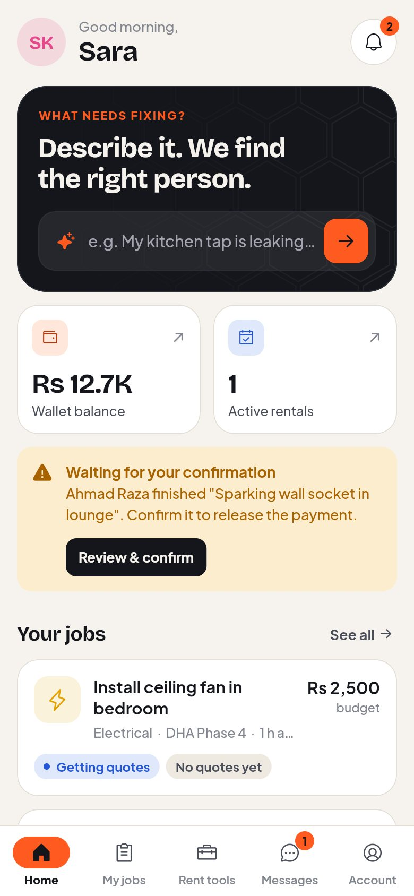
  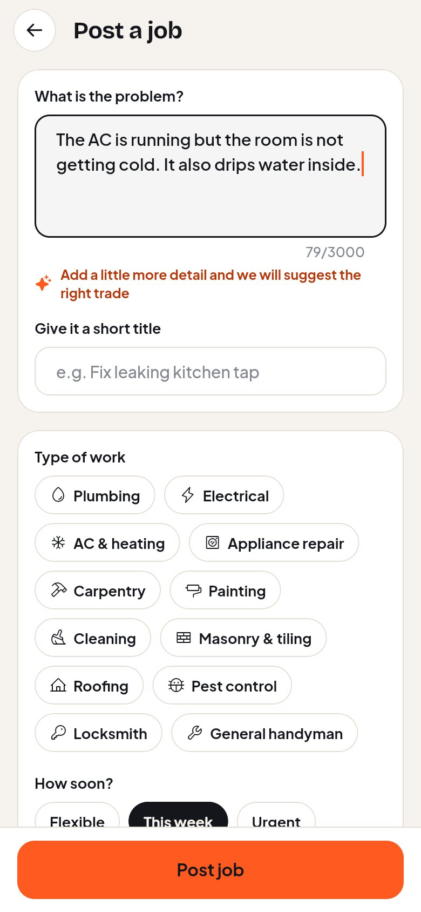
  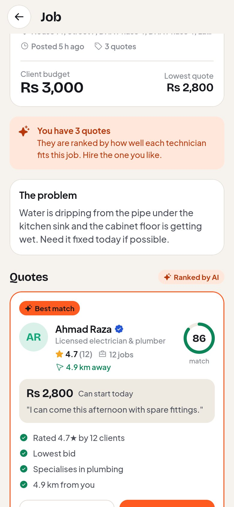
  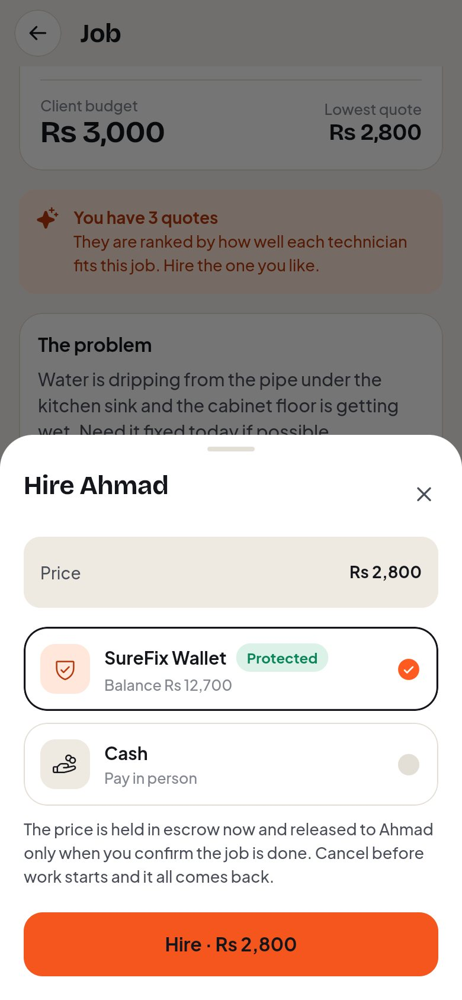

1. **Post a job.** Tap the dark card on Home (or *Post a job*). Describe the problem in your
   own words; SureFix suggests the type of work and urgency and shows what such jobs usually
   cost. Add a title, photos, a budget and the **job location** (your saved location is filled
   in; tap it to change). Posting is free. Technicians see the area and how far away it is —
   never your address until you hire them.
2. **Or ask one technician.** Open a technician's profile → **Request**. Only they see the
   job; if they decline or stay silent, **Open to all technicians**.
3. **Compare quotes.** Quotes arrive live, ranked by match score with the reasons. Tap
   **Message** to ask a question before hiring.
4. **Hire.** Choose **SureFix Wallet** (the price is held in escrow — if your balance is
   short you can add money right there) or **Cash** (you pay in person; not protected).
5. **Follow the job.** *Hired → On the way → Working → Finished* updates live. You can cancel
   until work starts and your money comes straight back.
6. **Confirm.** When the technician marks the work finished you see their note and photos.
   **Confirm & release payment** pays them. Not happy? **Report a problem** instead and an
   admin will step in.
7. **Review.** Rate 1–5 stars. Reviews appear on the technician's profile.

**Smart Match** ranks every technician for a problem you describe, before you post anything;
nearer technicians rank higher and the reasons say how far each one is.
**Saved** keeps technicians and tools you marked with the heart.

### Finding someone near you

  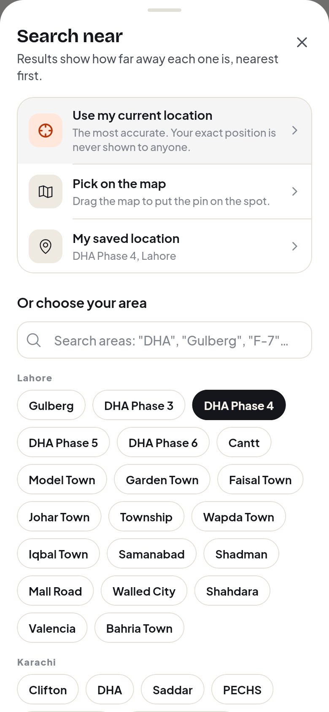
  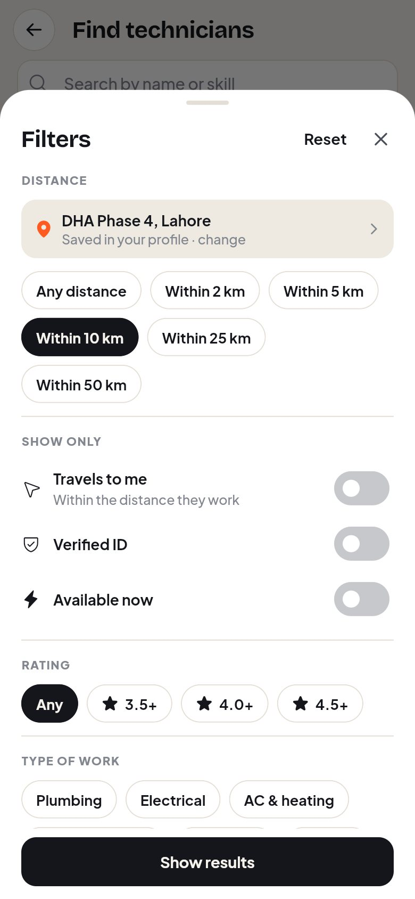
  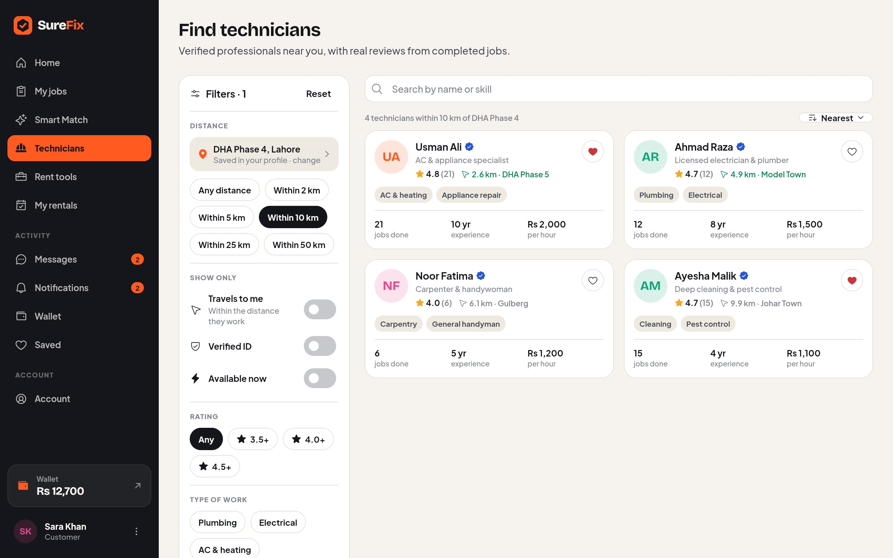

1. **Say where you are.** Tap the location chip (*Near …* or *Set your location*) on
   Technicians, Rent tools or Smart Match. Choose **Use my current location** (your phone or
   browser asks permission once), **Pick on the map** (drag the map until the pin is on the
   spot), or tap your **area** in the list. Your saved profile location is used until you do.
2. **Filter.** On a phone tap **Filters**: *Distance* (any, or within 2 / 5 / 10 / 25 / 50 km),
   *Travels to me* (only technicians whose working range reaches you), *Verified ID*,
   *Available now*, *Rating* and *Type of work* — then **Show results**. Tools have price per
   day, *In stock* and *Buy monthly* instead. On the website the filters sit on the left and
   apply as you click.
3. **Sort.** Results are **nearest first** once SureFix knows where you are; the sort menu
   switches to top rated, price, most jobs and so on. Every card shows the distance and area,
   in green when it is within 5 km.

Set your own location in **Account → Edit profile → Your location**. Only the area name and
distances are ever shown to others.

### Renting and buying tools

  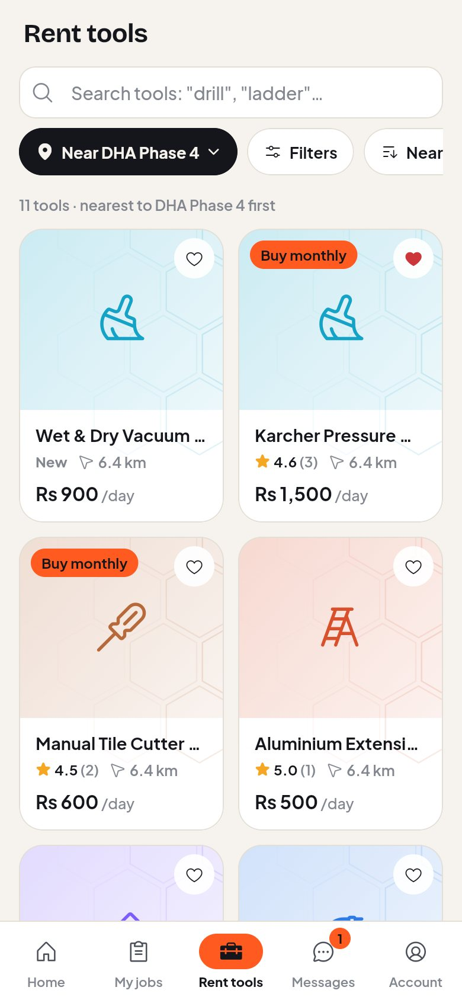
  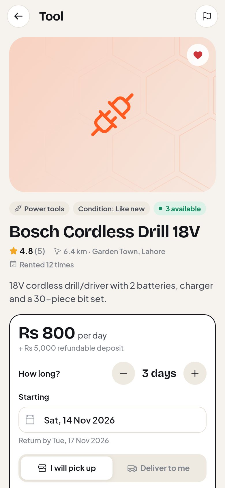
  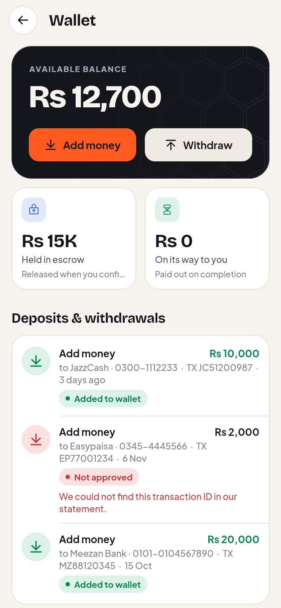
  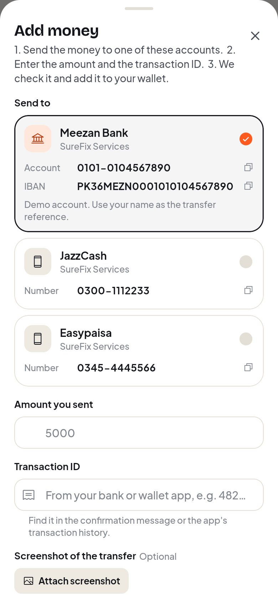

1. **Rent tools** → pick a tool → choose the days, the start date, and **pickup** or
   **delivery** → **Request to rent** → pay by wallet (cost + refundable deposit held) or cash.
2. The supplier approves or declines. Once approved you see the pickup address and their
   phone number under **My rentals**; if declined, a wallet payment is refunded in full.
3. Return it on time: each late day costs one day of rent, taken from the deposit.
4. Tools marked **Buy monthly** can be bought in installments: after approval, pay each
   month from **My rentals** or in cash to the supplier.

### Wallet

- **Add money:** Wallet → **Add money** lists SureFix's bank and mobile-wallet accounts (tap a
  number to copy it). Send the money from your banking app, then enter the amount and the
  **transaction ID** from the confirmation message, and attach a screenshot if you like. It shows
  as *Waiting for review* until an admin checks it; then it is added to your wallet. If it can't
  be matched you are told why.
- **Withdraw:** Wallet → **Withdraw**, enter the amount and your bank or JazzCash/Easypaisa
  account (remembered for next time). The amount is set aside at once and sent after a check;
  if it is rejected the money comes back. You can cancel a request while it is waiting.
- See what is **held in escrow**, and every movement in the ledger.
Wallet payments are protected; cash is not.

---

## Technician

  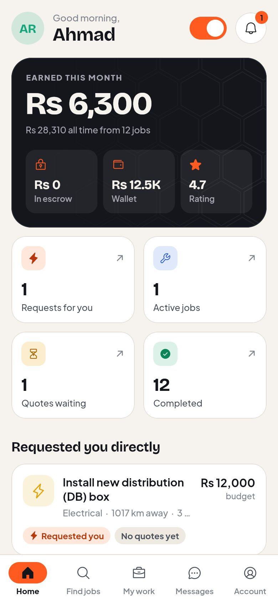
  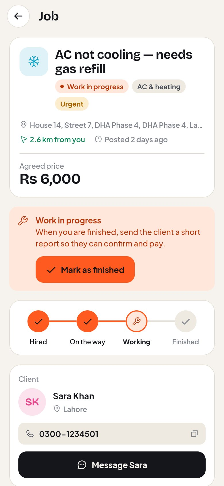

1. **Set up your profile** (Account → Edit profile): headline, skills, hourly rate,
   experience, portfolio photos, **where you work from** and **how far you travel** (5–50 km).
   Skills decide which jobs are suggested to you; clients near you see you first, and
   *Travels to me* only shows you to clients inside your range.
2. **Verify your identity** (Account → Identity verification): ID photo and a selfie. Verified
   technicians rank higher and show the blue seal.
3. **Find jobs.** Home shows direct requests and new jobs for your skills; **Find jobs** shows
   how far each job is from you and filters by distance, your skills or a trade, urgency and
   budget (sort by *Nearest* to see the closest first). New matching jobs arrive with an alert.
4. **Quote.** Enter your price (a typical range is shown, and what you receive after the 10%
   fee on wallet payments), when you can start, and a message.
5. **Do the job.** When hired, tap **I'm on my way → Start work → Mark as finished** and add
   a short report with photos. You may withdraw before starting if something comes up.
6. **Get paid.** Wallet jobs pay into your wallet the moment the client confirms. If they do
   not respond within 72 hours you can close the job yourself. **Wallet → Withdraw** pays out.

Use the switch on Home to mark yourself **busy**.

---

## Supplier

  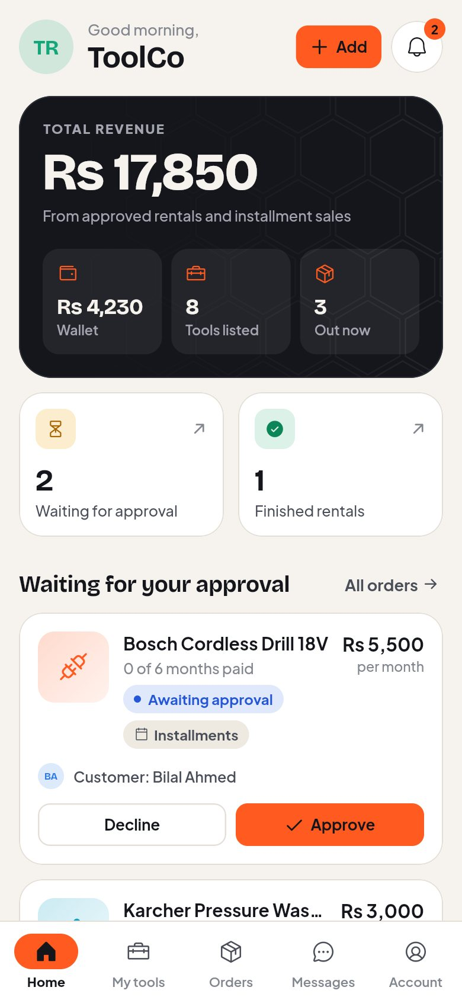
  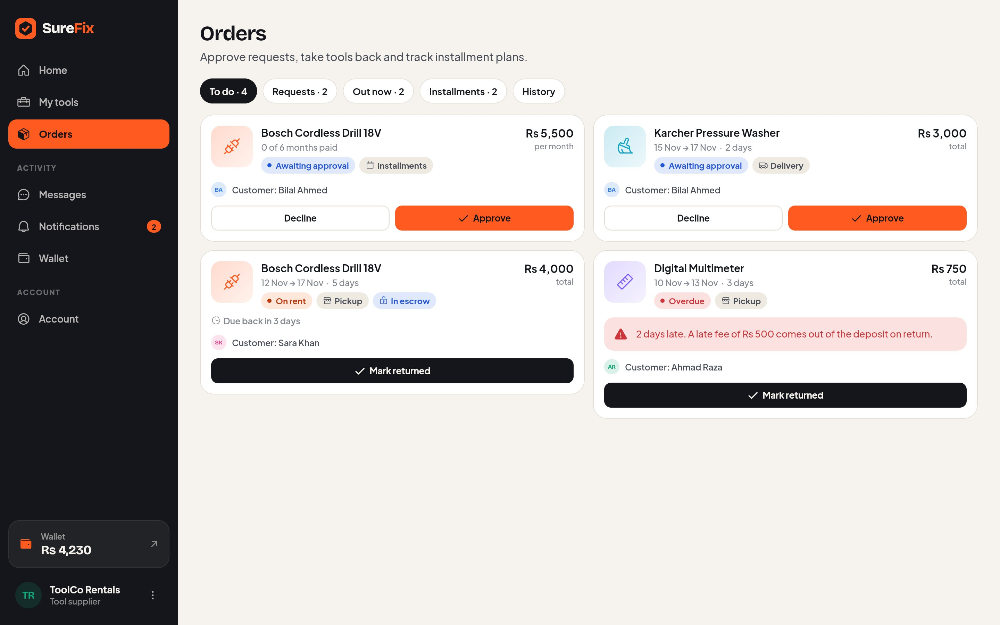

1. **Add your pickup address and shop location** (Account → Edit profile). Customers see how
   far each of your tools is from them and can search within a distance; the street address is
   only shared after you approve a pickup.
2. **List tools** (My tools → Add): photos, daily rate, deposit, stock, and optionally a full
   price with a number of monthly installments.
3. **Orders.** Approve or decline requests; stock is reserved automatically. **Mark returned**
   when a tool is back — you are paid, the deposit is refunded, and late fees are applied.
4. **Installment plans.** Record a month paid in cash, or the customer pays from their wallet.
5. Hide a tool any time with the **Listed** switch instead of deleting it.

---

## Admin

  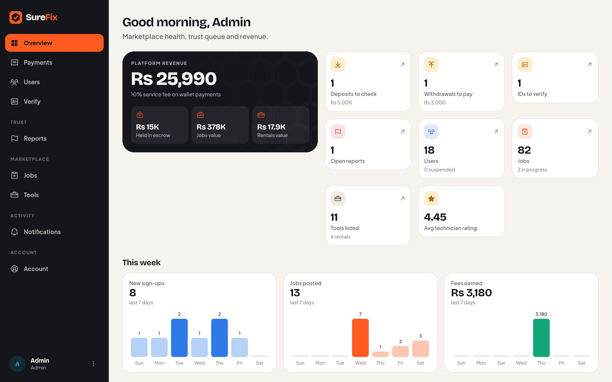

- **Overview** — platform revenue, money held in escrow, this week's sign-ups, jobs and fees,
  who is on the platform, and whether the AI service is online.
- **Users** — search, suspend / reactivate, delete (blocked while the account has a job in
  progress or a tool out on rent).
- **Verify** — compare each ID with the selfie; approve or reject with a reason.
- **Reports** — open the reported job, tool or profile; resolve, dismiss, or suspend the user.
- **Disputes** — open any job in progress → **Refund client** or **Release to technician**.
- **Payments** — the payments desk:
  - **Deposits:** each shows who sent it, the amount, the transaction ID (tap to copy), which
    company account it went to and the screenshot if attached. Check your bank or wallet
    statement, then **Approve** (correct the amount if a different amount arrived) or
    **Reject** with a reason.
  - **Withdrawals:** send the money to the account shown, then **Mark as sent** (add your
    transfer reference), or **Reject** with a reason — the money returns to their wallet.
  - **Ledger:** every wallet movement, filterable by type.
  - **Company accounts:** add, edit, hide or show the accounts users send money to. **Replace
    the demo accounts with your real ones before going live.**

  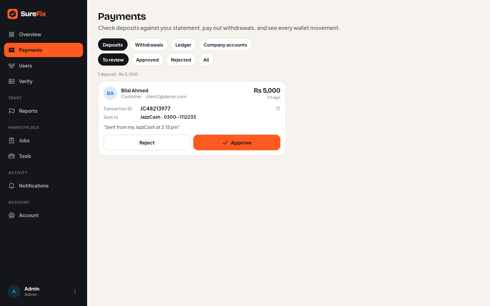

---

## Everyone

- **Messages** — chat about a job or a tool, with photos, typing and read receipts.
- **Notifications** — tap one to open the job, rental or page it is about.
- **Forgot password** — on the log-in screen: enter your email, then the 6-digit code.
  (Without an email server the code is shown on screen and printed in the backend console.)
- **Appearance** — Account → Auto / Light / Dark.
- **Help & FAQ**, **Terms** and **Privacy** — under Account → Support.
